<p align="center">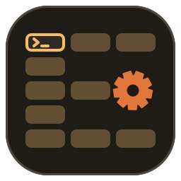</p>

<h1 align="center">EVE-Maj Rusty</h1>

<p align="center">
  Live thumbnail previews of your EVE Online clients, with activity overlays, alerts and hotkeys.<br>
  A Rust port of <a href="https://github.com/mrmjstc/eve-maj-preview">EVE-Maj Preview</a> with native Linux (Hyprland) support.
</p>

<p align="center">
  <a href="https://github.com/tylort69/eve-majRusty/actions/workflows/ci.yml"></a>
  <a href="https://github.com/tylort69/eve-majRusty/releases"></a>
  <a href="LICENSE"></a>
</p>

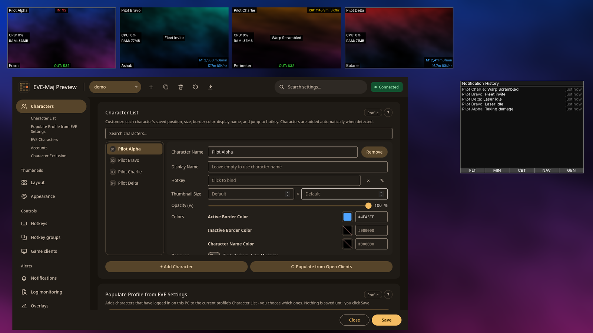

<sub>Every screenshot here comes from a sandboxed demo session: the "clients" are stand-in windows, and the pilots,
systems and log lines are made up. No real game client, character or account is shown.</sub>

## Contents

- [Features](#features)
- [Platform status](#platform-status)
- [Install on Linux (Hyprland)](#install-on-linux-hyprland)
- [Using it](#using-it)
- [The settings window](#the-settings-window)
- [Building for Windows](#building-for-windows)
- [Project layout](#project-layout)
- [Privacy](#privacy)
- [Contributing, security and credits](#contributing-security-and-credits)

## Features

### Live thumbnails with activity overlays

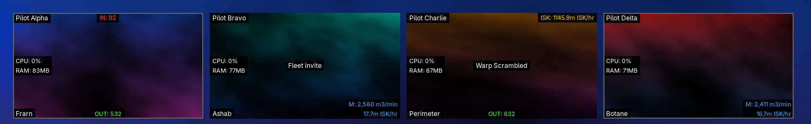

Each EVE client gets a live, GPU-rendered thumbnail that stays on top, even over fullscreen clients. Click one to
bring that client forward, right-drag to move it (Ctrl+right-drag moves them all), and Shift+click to leave it out of
hotkey cycling. Thumbnails snap to each other and to screen edges, and each character can have its own border color,
size and opacity.

Read from EVE's chat and game logs, each thumbnail can show:

- **System name**, updated on every jump.
- **Combat**: incoming (`IN`) and outgoing (`OUT`) damage per second.
- **Mining**: m3 per minute and estimated ISK per hour.
- **Bounties**: ISK per hour from bounty payouts.
- **Resources**: the client's CPU and RAM use.

### Alerts that find the right client

The same thumbnails flash alerts the moment something happens: fleet invites, warp scrambles and disruptions,
decloaks, cargo full, taking damage, idle mining lasers, Travel Mode's left-behind warning and more (over 30 types). Each
alert type can show a border, play a sound, speak through text-to-speech, and be throttled or muted per character.

### Client List and History Panel

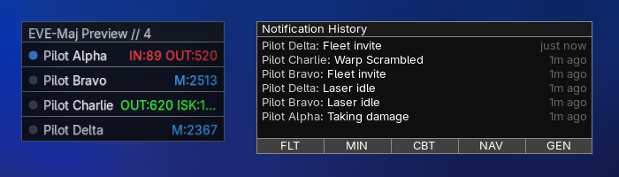

- **Client List** (left) is a compact alternative to thumbnails: one row per client, with a status dot and the newest
  alert, live stats or system name. It suits large fleets of clients. Click a row to focus that client.
- **History Panel** (right) collects recent alerts from every character, with fleet, mining, combat, navigation and
  general filters. Click an entry to jump to that client.

### Region selection for layouts

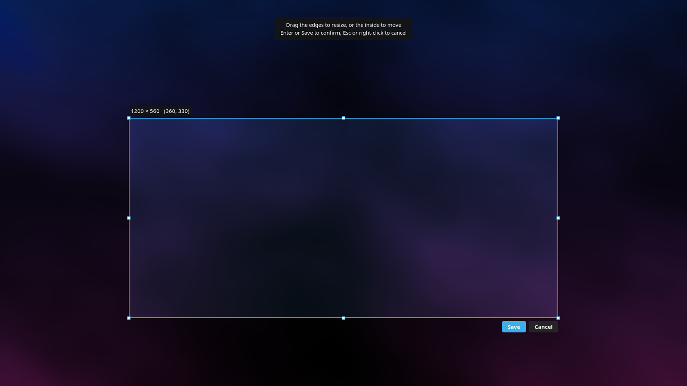

Drag out the screen area your thumbnails should fill, then fine-tune it by dragging its edges. The layout system fits
every thumbnail into that region in the order you choose.

### Hotkeys, groups and window management

- Cycle through all clients, logged-out clients or **hotkey groups** (e.g. a mining fleet), and bind a key to jump
  straight to any character or account.
- Minimize or close all clients at once, and move each client back to its saved window position on login.
- Switch profiles with a hotkey, or with an `evemajpreview://` link from a browser, Stream Deck or script.

### Themes for the settings window

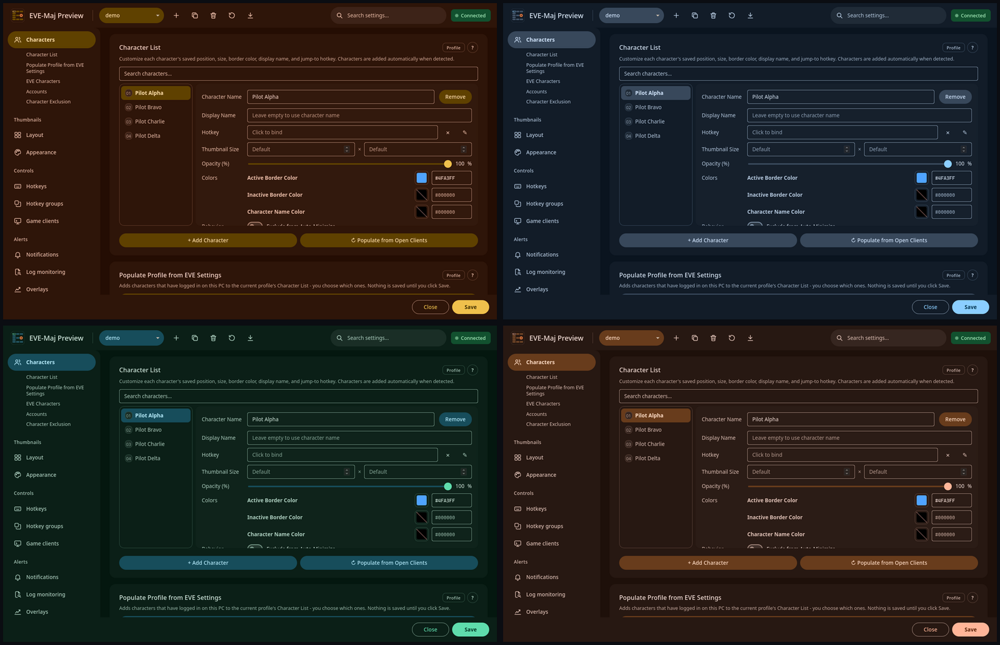

Pick a faction theme (Amarr, Caldari, Gallente, Minmatar, Guristas, Serpentis, Sansha's Nation, Triglavian) or build a
custom one from up to four hex or RGB colors. The app logo in the window follows the theme too.

## Platform status

| | Linux (Hyprland) | Windows |
|---|---|---|
| Thumbnails, clicking, dragging, snapping, layouts | ✅ | ✅ |
| Notifications, tray, profile switching | ✅ | ✅ |
| Hotkeys and hotkey groups | ✅ | 🚧 not yet ported |
| Chat-log monitoring, alerts, sounds, text-to-speech | ✅ | 🚧 not yet ported |
| DPS, mining, bounty and CPU/RAM overlays | ✅ | 🚧 not yet ported |
| Client List, History Panel, region selection | ✅ | 🚧 not yet ported |
| Settings window | ✅ `eve-maj-config` | 🚧 `config.exe` not yet ported |

Linux is the primary platform of this port. On Windows, the original
[EVE-Maj Preview](https://github.com/mrmjstc/eve-maj-preview) is still the complete option. Profiles use the same
JSON format in both, so settings carry over. Unported settings still load and save, and log a warning when enabled.

## Install on Linux (Hyprland)

You need [Hyprland](https://hyprland.org) and a current stable Rust toolchain (from [rustup](https://rustup.rs) or
your distro).

**1. Install the build dependencies.** On Arch:

```sh
sudo pacman -S --needed rust wayland mesa libdrm cairo pango gtk3 webkit2gtk-4.1 xdg-utils wl-clipboard
```

On Debian or Ubuntu:

```sh
sudo apt install build-essential pkg-config libwayland-dev libegl-dev libgbm-dev libdrm-dev libcairo2-dev libpango1.0-dev libgtk-3-dev libwebkit2gtk-4.1-dev xdg-utils wl-clipboard
```

**2. Build both binaries.** `cargo linux` is a repo alias for a release build of `eve-maj-preview` and
`eve-maj-config`:

```sh
git clone https://github.com/tylort69/eve-majRusty.git
cd eve-majRusty
cargo linux
```

**3. Install them side by side** (each one starts the other, looking next to itself first and then on `PATH`):

```sh
install -Dm755 -t ~/.local/bin target/x86_64-unknown-linux-gnu/release/eve-maj-{preview,config}
```

**4. Start it** from your Hyprland config (`exec-once = eve-maj-preview`), or turn on Run on Startup in the settings
window. That writes an XDG autostart entry, which Hyprland runs only through uwsm or a tool such as `dex`.

Optional extras:

- Sounds play through `ffplay`, `mpv`, `pw-play` or `paplay`; spoken alerts need `spd-say` (speech-dispatcher) or
  `espeak-ng`.
- `layerrule = noanim, eve-maj-preview` in `hyprland.conf` stops thumbnails animating in and out.
- `eve-maj-preview --profile NAME.json` starts with a given profile; `--fps N` (default 30) sets the refresh rate.

## Using it

- **Finding clients.** EVE clients are matched by the Wine/Proton process `exefile.exe` (or a window class of that
  name). A window filter's `class_names` also match Hyprland window classes, e.g. `steam_app_8500`.
- **Settings and logs** live in `~/.config/eve-maj/`: profiles, `accounts.json` and `eve-maj.log`. Edits to the active
  profile's JSON apply while the app runs.
- **Chat-log monitoring** needs EVE to write logs (in game: Esc → Chat Channel Settings → Log chat to file). If the
  log folders aren't set, they're found in the running client's Wine prefix (`WINEPREFIX`, or Proton's
  `STEAM_COMPAT_DATA_PATH/pfx`) under `drive_c/users/*/Documents/EVE/logs`.
- **Hotkeys** are registered as Hyprland binds while the app runs and removed when it exits. They appear in
  `hyprctl binds` as "EVE-Maj: ...".
- **Minimize** parks a client on the hidden `special:evemaj` workspace; clicking its thumbnail or cycling to it brings
  it back.
- **Auto-move** floats a client and moves it to its saved position. Save positions from the tray ("Save Client Window
  Positions") or per character in the settings window.
- **Tray icon** (any StatusNotifierItem host: Waybar, KDE, ...): settings, profiles, quick toggles, restore positions,
  the history panel, suspend hotkeys, close all, exit.
- **`evemajpreview://` links**: the app registers itself as the handler, and `xdg-open URL` forwards a link to the
  running instance.
- **Identify Displays** (Display Config) shows each monitor's number for three seconds.
- **Performance**: every thumbnail refresh is a GPU copy done by Hyprland, so lower `--fps` if you run many clients.
  RAM and CPU come from `/proc`; VRAM isn't available on Linux.
- **Desktop icon**: when the app writes a desktop entry, it installs its logo into your icon theme as
  `eve-maj-preview`.

## The settings window

`eve-maj-config` opens from the tray or on its own. Saving updates the running app straight away, and Live Preview
shows a change on the thumbnails before you save it. Advanced Mode (Preferences) shows the Overlays and System tabs and
the more detailed options.

<details>
<summary><b>Screenshots of every tab</b> (click to expand)</summary>

#### Characters
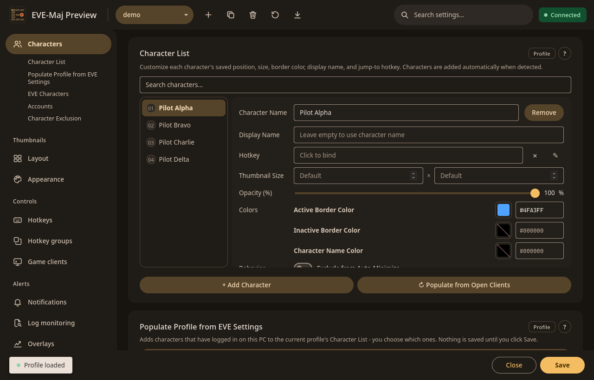
Per-character display names, border colors, thumbnail size and opacity, jump-to hotkeys and exclusions. Also imports
characters from your EVE settings and manages accounts.

#### Layout
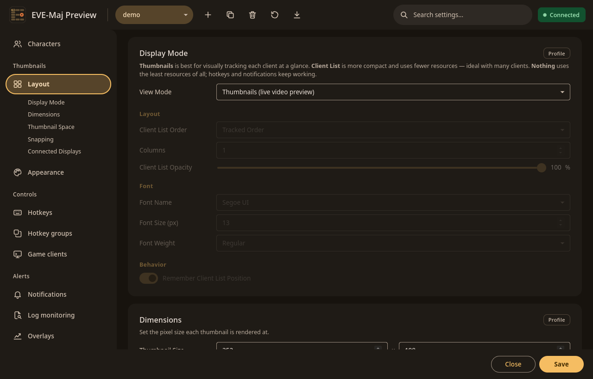
View mode (Thumbnails, Client List or Nothing), thumbnail size, layout regions and grids, snapping, and which displays
to use.

#### Appearance
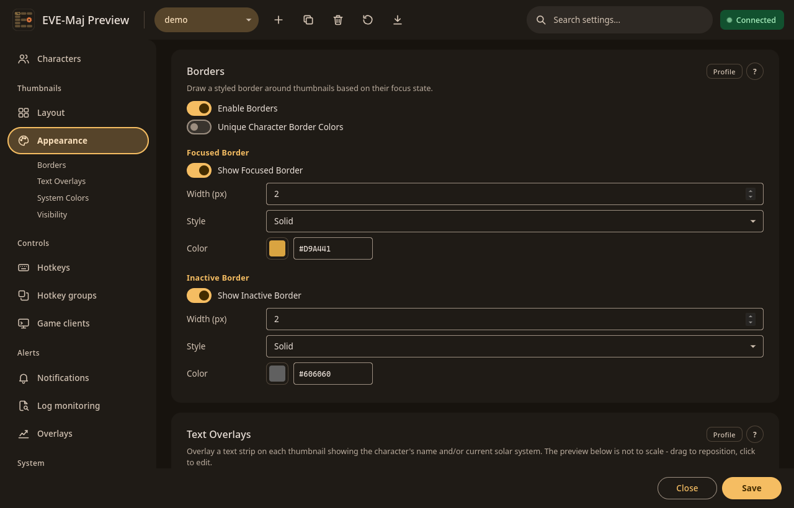
Focused and inactive borders, text overlays (name and system position, fonts, colors), system colors, and visibility
rules.

#### Hotkeys
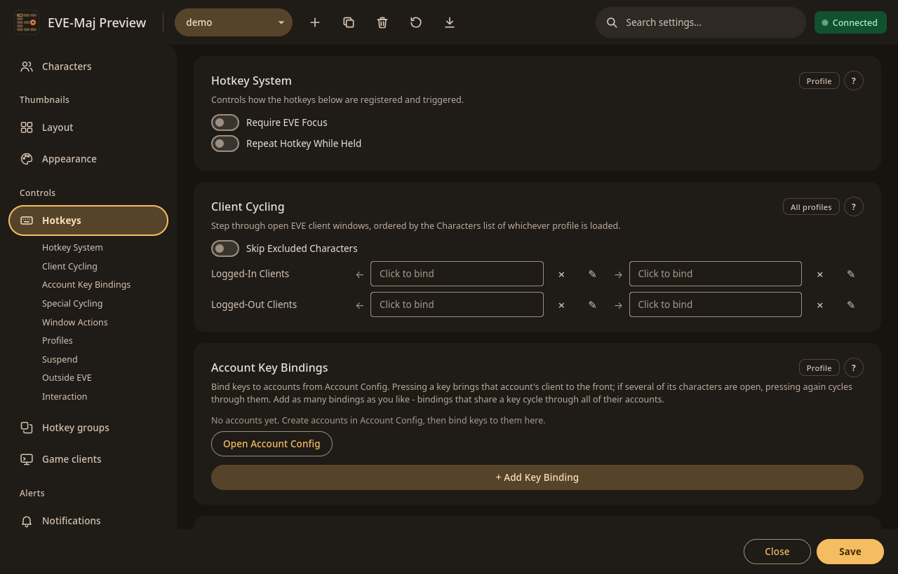
Client cycling, account key bindings, window actions, profile switching, suspend, and hotkeys that open apps or links.

#### Hotkey groups
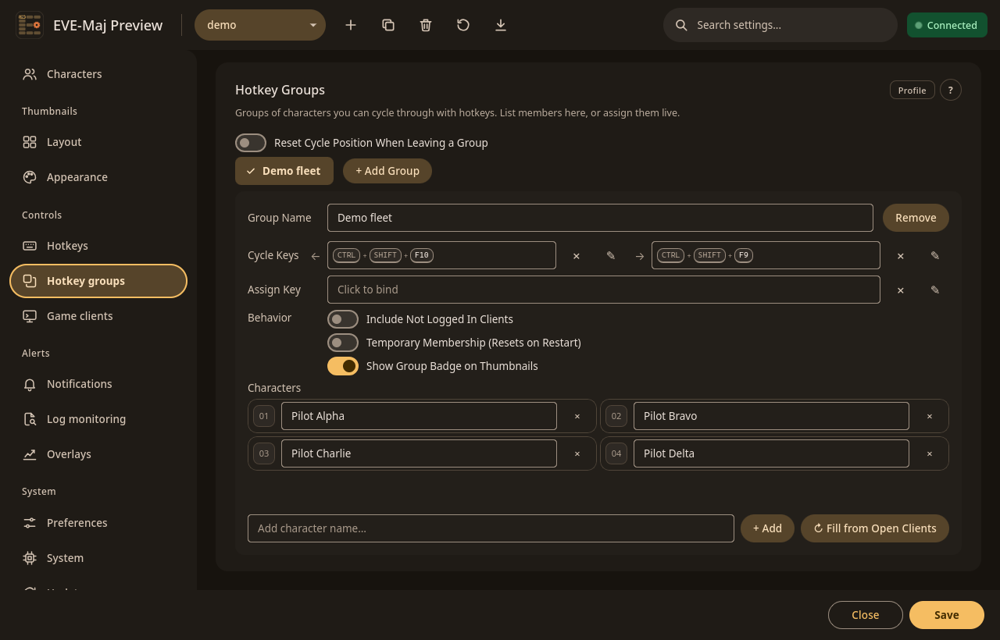
Named groups of characters with their own cycle keys, assign keys and a badge on their thumbnails.

#### Game clients
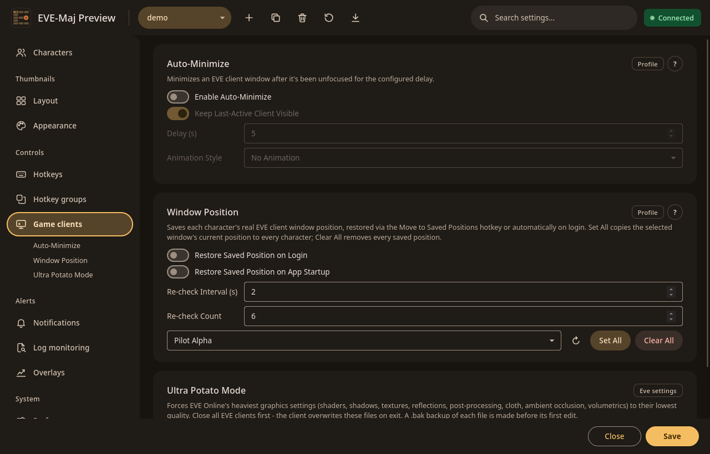
Auto-minimize, saved window positions and how they're restored, and Ultra Potato Mode for EVE's graphics settings.

#### Notifications
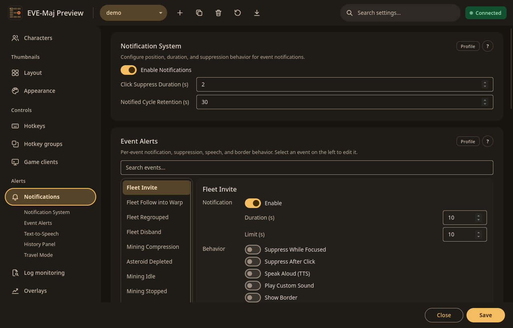
Every alert type with its duration, throttle, suppression, border, sound and text-to-speech options, plus
text-to-speech, History Panel and Travel Mode settings.

#### Log monitoring
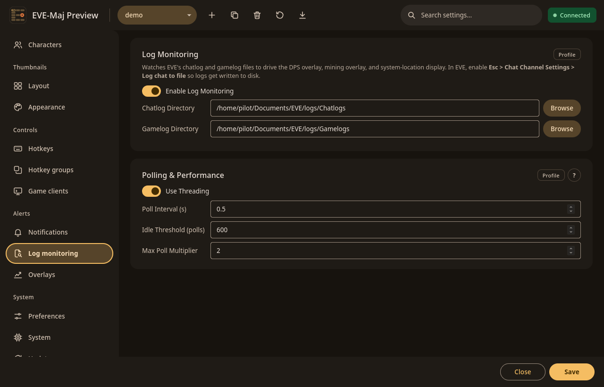
Where EVE's chat and game logs are, and how often they're read.

#### Overlays (Advanced Mode)
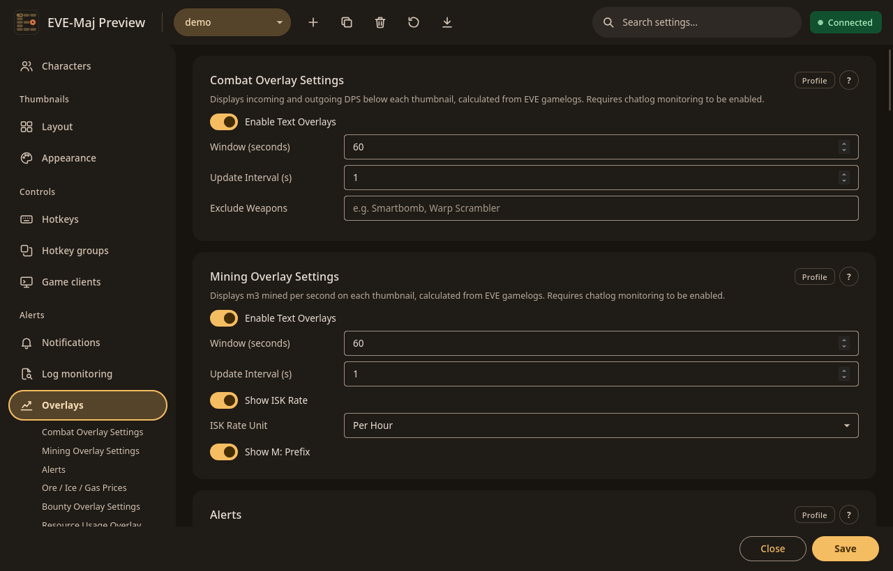
The combat, mining, bounty and resource overlays: averaging windows, positions, fonts and colors, the alerts, and the
ore, ice and gas price table for ISK/hr.

#### Preferences
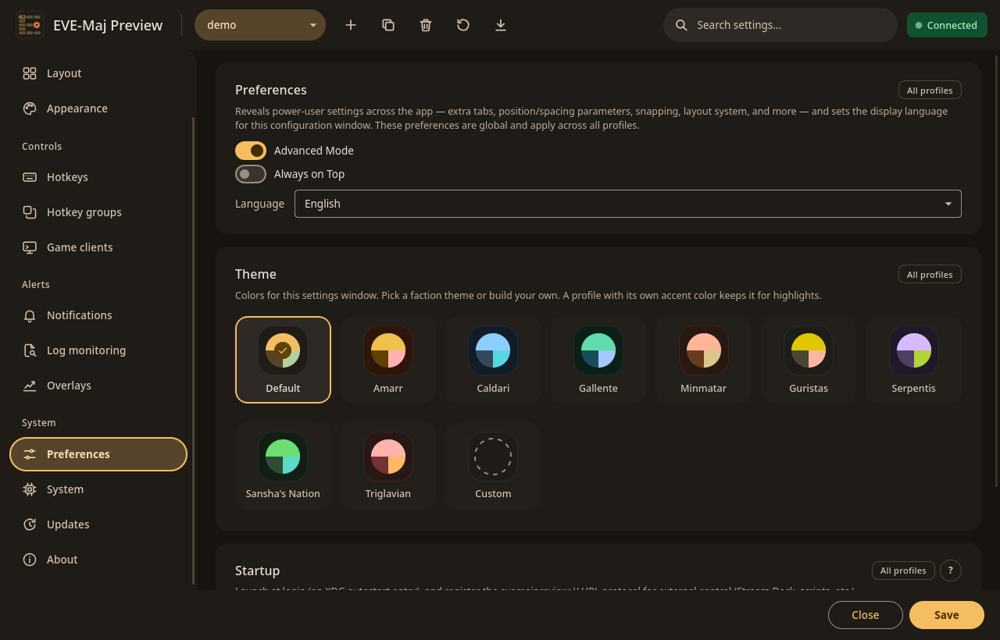
Advanced Mode, always on top, language (8 languages), the window theme, and startup options.

#### System (Advanced Mode)
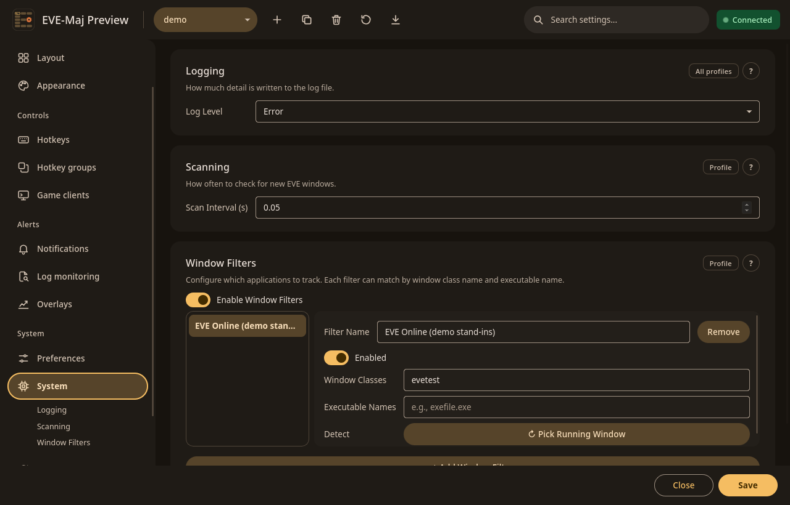
Logging, scan interval, and the window filters that decide which windows count as EVE clients.

#### Updates
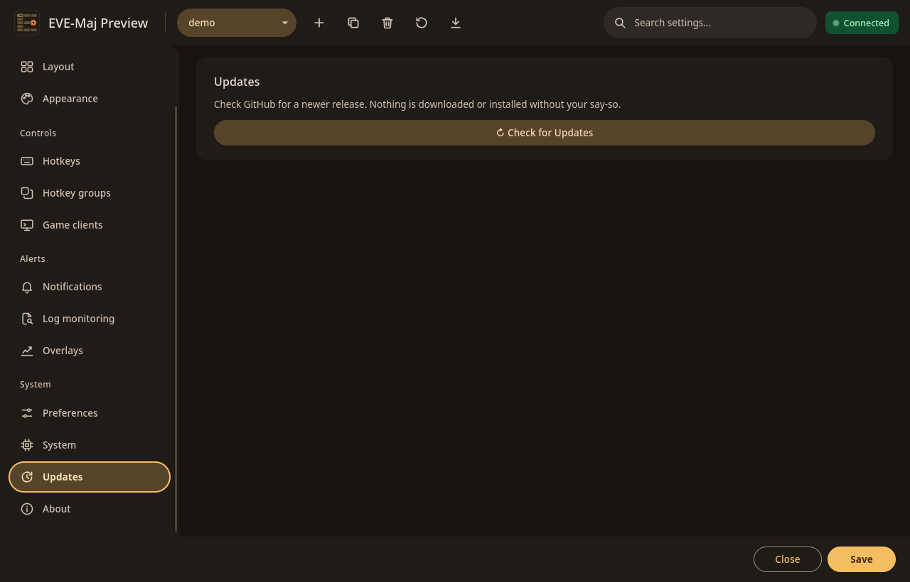
Checks GitHub for a newer release. Nothing is downloaded without asking.

#### About
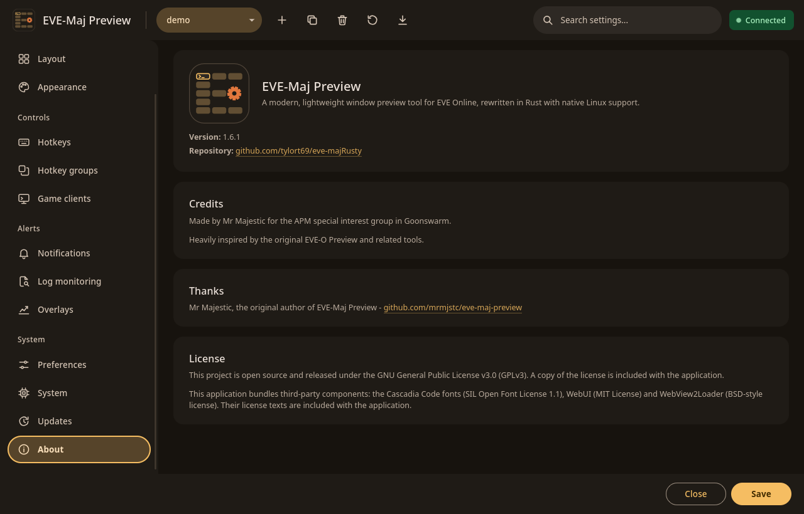
Version, credits and licenses.

</details>

## Building for Windows

The Windows binaries cross-compile from Linux with MinGW (the repo's default build target):

```sh
rustup target add x86_64-pc-windows-gnu
sudo apt install gcc-mingw-w64-x86-64   # provides the linker and windres
cargo build --release
```

On Windows itself, `cargo build --release --target x86_64-pc-windows-gnu` (or `-msvc`) works the same way. Run the
unit tests on a Linux host with `cargo t`.

## Project layout

| Crate | What it is |
|---|---|
| `crates/core` | Platform-independent model: config, logging, protocol URLs, chat-log parsing, trackers, accounts, update checks. Unit-tested on any host. |
| `crates/preview` | The `eve-maj-preview` binary: the Windows app (`src/*.rs`) and the Linux/Hyprland front end (`src/linux/`). |
| `crates/config` | The `eve-maj-config` settings window for Linux: the settings page (`ui/`) in a WebKitGTK window. |
| `crates/app` | Windows subsystems: IPC, sound, text-to-speech, updater, displays, mouse hook. |
| `crates/win` | Thin helpers over the Win32 API. |

`assets/` holds the logo, the app icon and the embedded Cascadia fonts. `docs/screenshots/` holds the images above.

## Privacy

EVE-Maj Rusty runs entirely on your computer. It reads EVE's local log files and window list, and stores its settings
in `~/.config/eve-maj/`. The only network request it makes is the update check against this repository's GitHub
releases, which you can turn off in Preferences. It has no telemetry.

When you report a bug, check logs and screenshots for character names, systems, chat channels and anything else you'd
rather not share. The issue templates remind you.

## Contributing, security and credits

- Bug reports and feature requests: [open an issue](https://github.com/tylort69/eve-majRusty/issues/new/choose).
  Pull requests are welcome; see [CONTRIBUTING.md](CONTRIBUTING.md).
- Security problems: please report them privately as described in [SECURITY.md](SECURITY.md).
- Release history: [CHANGELOG.md](CHANGELOG.md).

EVE-Maj Rusty is a port of [EVE-Maj Preview](https://github.com/mrmjstc/eve-maj-preview) by Mr Majestic, itself
inspired by EVE-O Preview. EVE Online and all related marks are trademarks of CCP hf. This project is not affiliated
with or endorsed by CCP.

Licensed under the [GPL-3.0](LICENSE), like the project it is ported from. The bundled Cascadia fonts are under the
SIL Open Font License ([CascadiaCode-LICENSE.txt](CascadiaCode-LICENSE.txt)).
